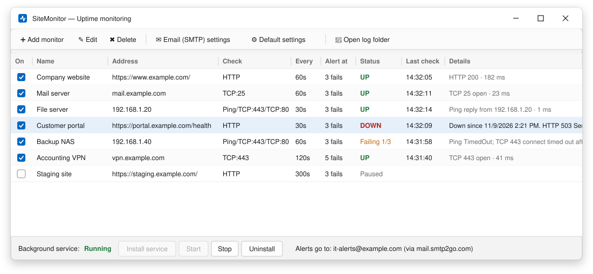
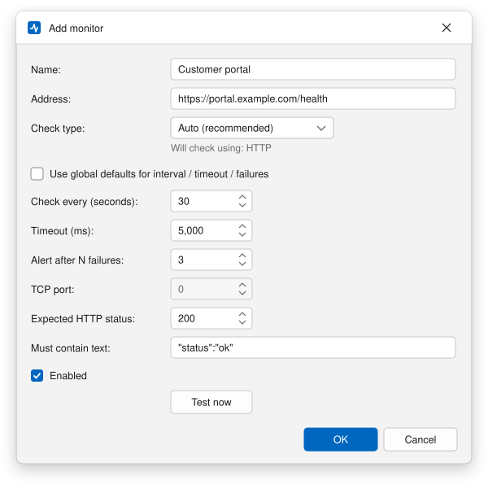
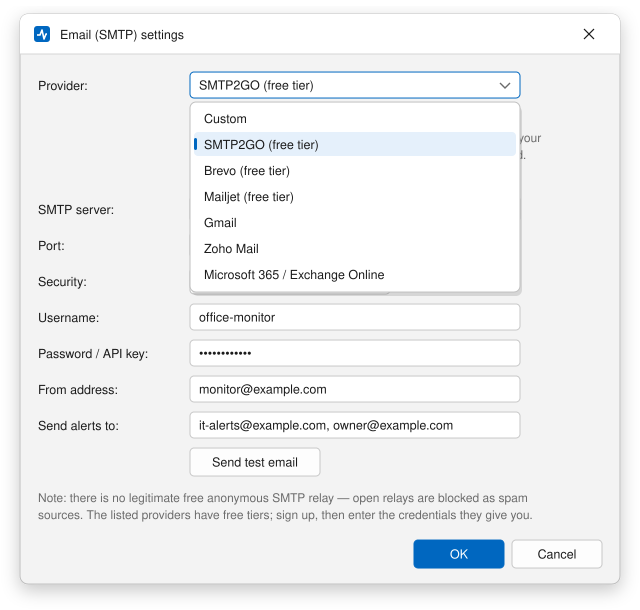
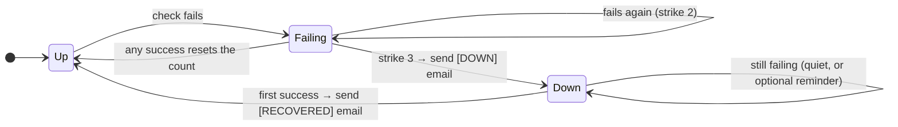

<h1 align="center">Uptime Sentinel</h1>

<p align="center">
  <b>Three strikes, then it emails you.</b><br>
  A tiny Windows service that watches your websites, servers and devices,<br>and tells you the moment one of them stops answering.
</p>

<p align="center">
  <a href="https://github.com/InterconnectedSystems/uptime-sentinel/releases/latest/download/SiteMonitor-win-x64.zip">
    
  </a>
</p>

<p align="center">
  <a href="https://github.com/InterconnectedSystems/uptime-sentinel/releases">All releases</a> ·
  <a href="docs/USER-GUIDE.md">User guide</a> ·
  <a href="#-60-second-setup">60-second setup</a> ·
  <a href="LICENSE">MIT license</a>
</p>

<p align="center">
  
  
  
</p>

---

It's 2:14 AM and your website goes down. At 9:40 AM you find out, from a customer.

Uptime Sentinel is for the gap between those two moments. Give it a list of URLs, domain names or IP addresses.
It checks them quietly in the background, as often as you like. When something fails **three checks in a row**, you get an
email. When it comes back, you get another one. That's the whole job, and it does it without a cloud account, a monthly
fee, or a dashboard you have to remember to look at.

## ✨ What it does

| | |
|---|---|
| 🌐 **Watches anything with an address** | Websites (`https://…`), domain names, IP addresses, or a specific port (RDP, SQL, mail…). |
| 🧠 **Picks the right check for you** | URLs get an HTTP check. Bare hosts get a ping, then fall back to ports 443 and 80, because plenty of servers ignore ping. |
| 🔁 **Three strikes, not one** | One dropped packet isn't an outage. You choose how many consecutive failures count as "down" (default **3**). |
| ✉️ **Emails that tell you something** | `[DOWN]` with the address and the last few errors with timestamps. `[RECOVERED]` with how long it was out. Optional "still down" reminders. |
| ⏱️ **Your schedule** | Every 10 seconds, every hour, or anything in between, set per site. Timeouts and failure counts are adjustable too. |
| 🔍 **Checks the content too** | An HTTP check can require a specific status code, or text that must appear on the page (e.g. `"status":"ok"`). |
| 🪶 **Very light** | A single Windows service. In testing, CPU sat at about 0% between checks. |
| 🔒 **Keeps your password safe** | The SMTP password is encrypted with Windows DPAPI, and the settings folder is admin-only. |
| 🚀 **Always on** | Runs as a Windows Service: starts at boot, keeps running when nobody is logged in, and Windows restarts it if it ever crashes. |

## 🖼️ A look inside

> **Note:** the images below are **illustrations** drawn from the app's real window layouts, with the same fields,
> columns and wording. They are not screenshots. The email and log further down are real output from a test run.

<p align="center">
  
  <br><sub><i>Illustration: the main window. Live status for every monitor, plus start/stop controls for the background service.</i></sub>
</p>

<table>
<tr>
<td width="50%" valign="top">
  
  <br><sub><i>Illustration: adding a monitor. Each one can have its own interval, timeout and strike count.</i></sub>
</td>
<td width="50%" valign="top">
  
  <br><sub><i>Illustration: email setup. Choose a provider from the dropdown and the server settings fill themselves in.</i></sub>
</td>
</tr>
</table>

### What lands in your inbox

This is the real email the service sent during testing. A test target was pointed at an address that never answers:

```text
Subject: [DOWN] Dead box is not responding

Dead box failed 3 consecutive checks and is considered DOWN.

Address:    10.255.255.1
Check:      TCP:80
Down since: 2026-11-09 23:08:36 +00:00

Recent failures:
  2026-11-09 23:08:36  TCP 80 connect timed out after 1500 ms
  2026-11-09 23:08:46  TCP 80 connect timed out after 1500 ms
  2026-11-09 23:08:56  TCP 80 connect timed out after 1500 ms

-- SiteMonitor on www
```

And the service log from the same run. A web app went down, triggered an alert, and was back 20 seconds later:

```text
2026-11-09 23:08:35 INFO  Web app: FAIL 1/3 HTTP error: Connection refused
2026-11-09 23:08:45 INFO  Web app: FAIL 2/3 HTTP error: Connection refused
2026-11-09 23:08:55 WARN  Web app is DOWN after 3 consecutive failures: HTTP error: Connection refused
2026-11-09 23:08:55 INFO  Sent email: [DOWN] Web app is not responding
2026-11-09 23:09:15 WARN  Web app has RECOVERED.
2026-11-09 23:09:15 INFO  Sent email: [RECOVERED] Web app is back up
```

## 🧭 How it decides something is down



If your mail server is unreachable when an alert fires, Uptime Sentinel doesn't drop the alert or spam retries.
It tries again after 1, 2, 4, 8 and 16 minutes, then every 30 minutes, and shows the email error next to the monitor until the
alert gets through.

## ⚡ 60-second setup

1. **[Download the zip](https://github.com/InterconnectedSystems/uptime-sentinel/releases/latest/download/SiteMonitor-win-x64.zip)** and unzip it.
2. Open **PowerShell as administrator** in that folder and run:
   ```powershell
   powershell -ExecutionPolicy Bypass -File .\install.ps1
   ```
3. In the window that opens, click **✉ Email (SMTP) settings**. Pick a provider, enter your login, and click **Send test email**.
4. Click **➕ Add monitor** and paste in a URL, domain or IP.
5. That's it. You can close the window, and the service keeps watching.

> **Windows SmartScreen:** the release isn't code-signed yet, so Windows may show *"Windows protected your PC"*.
> Click **More info → Run anyway**. Or build it yourself from source, as described below.

No .NET install is needed. Both programs are self-contained.

## 📮 About the "free SMTP relay"

An honest answer: **there's no such thing as a free, anonymous SMTP relay you can rely on.** Open relays get abused by
spammers and blacklisted within hours. Your alerts would land in spam, or nowhere.

The next best thing is a provider with a **free tier**. Uptime Sentinel's dropdown knows the server, port and encryption
settings for each one. Sign up, paste in your credentials, and you're done:

| Provider | Free allowance* | Good to know |
|---|---|---|
| **SMTP2GO** | 1,000 emails/month | Easiest setup. Verify your sender address |
| **Brevo** | 300 emails/day | The password is an *SMTP key*, not your login password |
| **Mailjet** | 200 emails/day | Username = API key, password = secret key |
| **Gmail** | ~500 emails/day | Needs 2-Step Verification and an **App Password** |
| **Zoho Mail** | Free plan | Use `smtp.zoho.eu` for EU accounts |
| **Microsoft 365** | With a paid mailbox | Microsoft is disabling password SMTP by default from Dec 2026 |
| **Custom** | — | Your ISP, your company mail server, or an internal relay |

<sub>*Checked November 2026. Providers change their plans, so check their sites.</sub>

An uptime monitor sends very little mail. Even the smallest free tier covers a lot of outages.

## 🪶 How light is "light"?

The service was measured on Linux with the same code that ships for Windows:

- **CPU:** about 0% between checks. Startup costs about 1 CPU-second.
- **Memory:** about 36 MB, of which about **9 MB** is its own working data. The rest is read-only program code.
  Expect Windows Task Manager to show a different figure.
- **Checks are asynchronous.** It doesn't use a thread per site, and all checks share one HTTP connection pool.
  Startup times are spread out so 50 monitors don't all fire in the same second.
- **The settings app only uses resources while it's open.** Close it and only the service keeps running.

## 🛠️ Build from source

You need the [.NET 8 SDK](https://dotnet.microsoft.com/download/dotnet/8.0). It builds on Windows, Linux or macOS and
cross-compiles the Windows executables:

```bash
git clone https://github.com/InterconnectedSystems/uptime-sentinel.git
cd uptime-sentinel
dotnet test                 # 35 tests, including real HTTP/TCP/SMTP round-trips against local listeners
./build/publish.sh          # → dist/SiteMonitor-win-x64.zip
```

| Project | What's in it |
|---|---|
| [`src/SiteMonitor.Core`](src/SiteMonitor.Core) | Checks, the three-strikes state machine, SMTP presets, config. Cross-platform and unit-tested. |
| [`src/SiteMonitor.Service`](src/SiteMonitor.Service) | The Windows Service (.NET Worker Service, trimmed, ~24 MB single file). |
| [`src/SiteMonitor.Gui`](src/SiteMonitor.Gui) | The WinForms settings app. |
| [`tests/`](tests) | xUnit tests. |
| [`build/`](build) | Publish script, installer and uninstaller. |

Settings live in `C:\ProgramData\SiteMonitor\config.json`, a plain JSON file you can edit by hand (comments allowed). The
service picks up changes within a second. The full reference is in the **[user guide](docs/USER-GUIDE.md)**.

## 📄 License

[MIT](LICENSE) © 2026 Interconnected Systems. Use it, fork it, ship it. A ⭐ is appreciated if it catches an outage for you.
